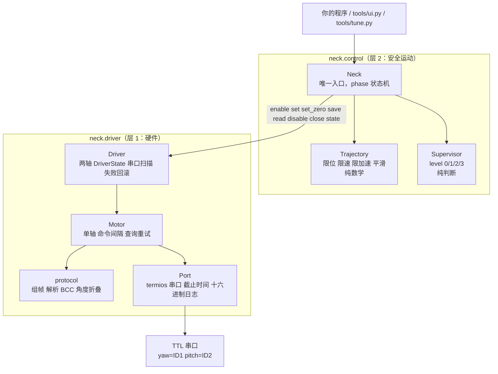
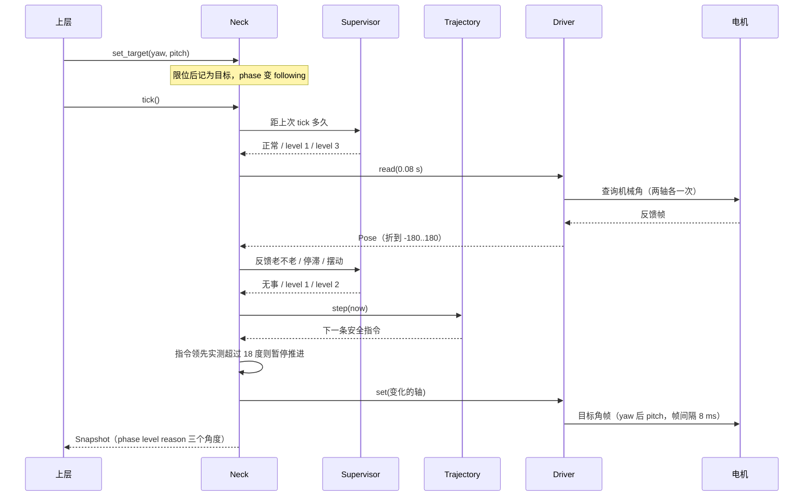
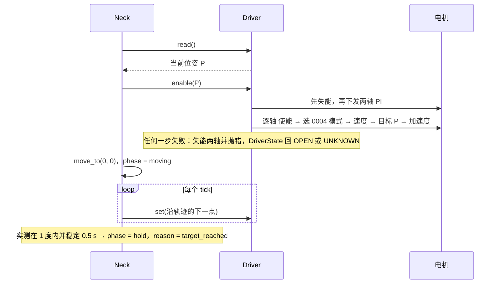
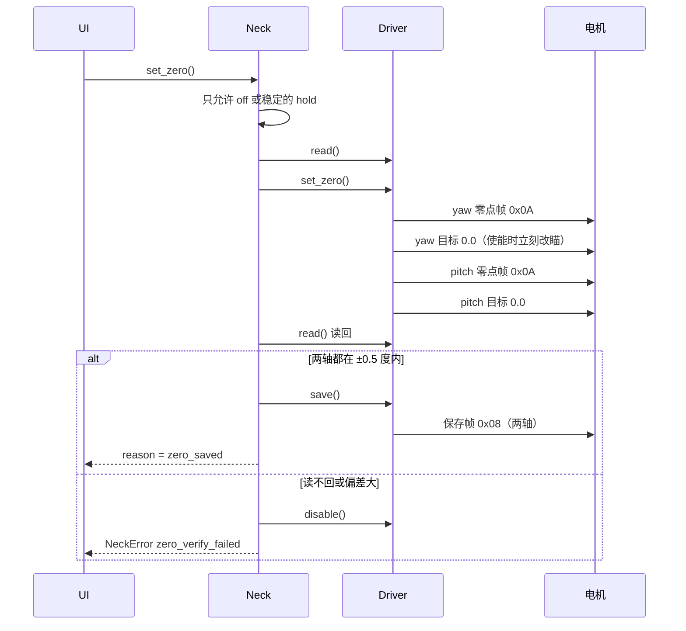
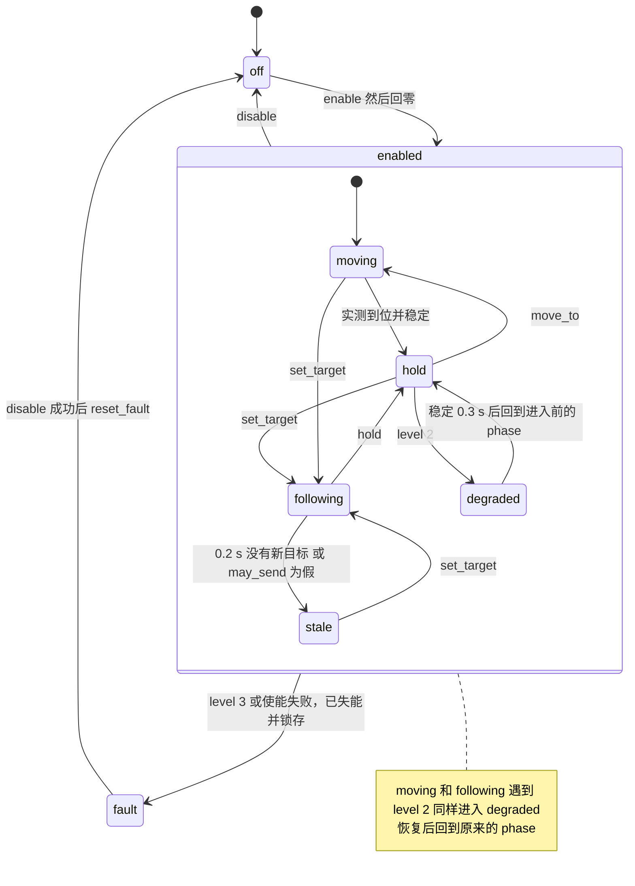
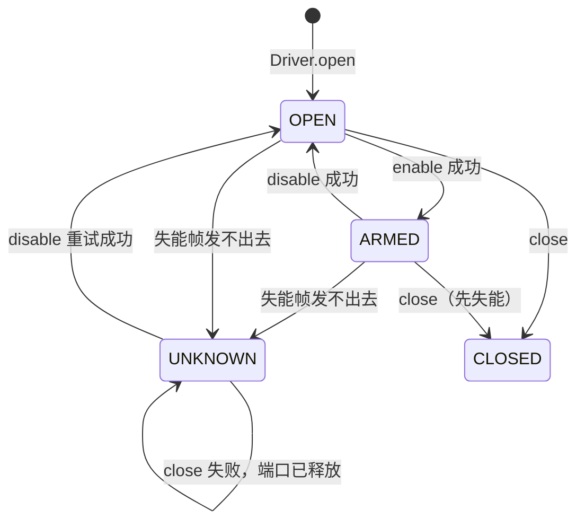
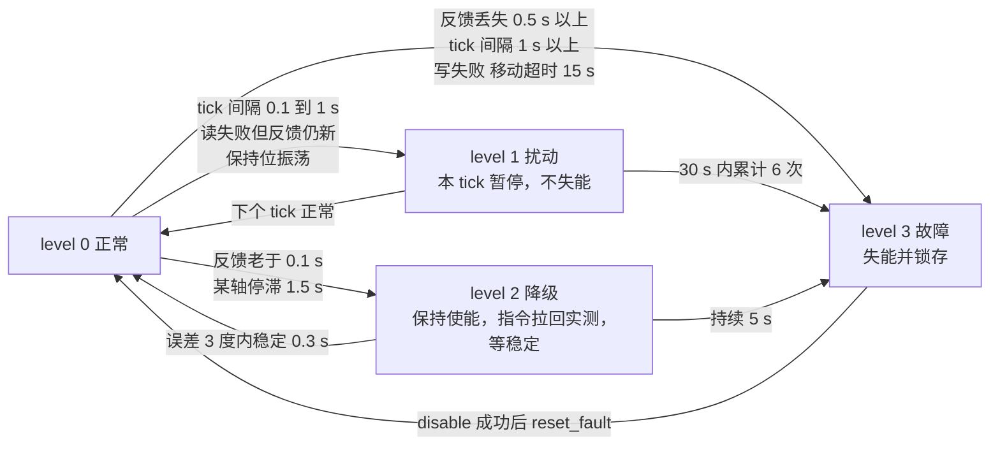

# 架构图

用 Mermaid 写的图，GitHub 和 Notion 里直接显示，改代码时顺手改这里。配合 [`回放.html`](回放.html)（双击打开，看一次真实运行的数据流）一起看。

## 1. 谁依赖谁

只能自上而下依赖。`control` 不碰串口，`driver` 不知道轨迹和保护。

## 2. 一个 tick 里发生什么

上层每 20–33 ms 调一次 `tick()`。

## 3. 使能与回零

## 4. 写零位（两轴）

## 5. Neck 的状态（phase）

## 6. Driver 的状态（DriverState）

## 7. 保护分级

