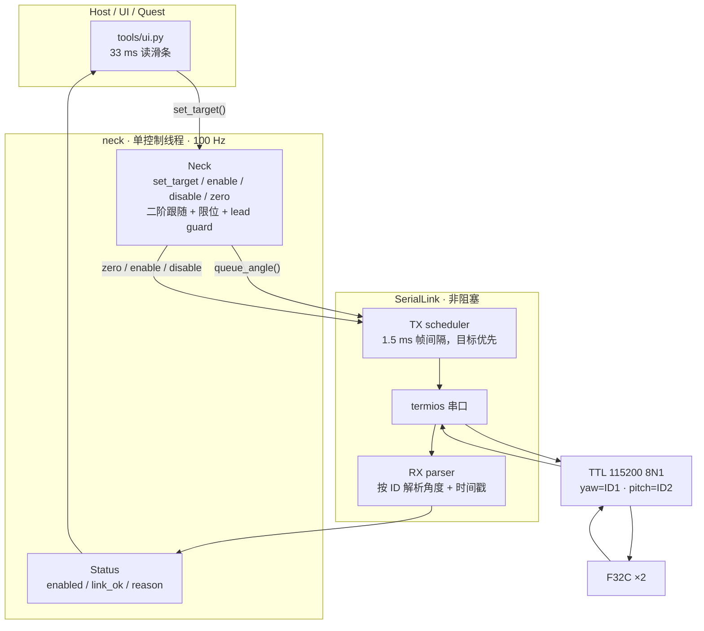

# 简化架构（当前主路径）

目标只有两个：**快速、丝滑地跟随 yaw/pitch 目标**，以及**把当前位置写成零位并保存到 flash**。旧的 `neck.driver` / `neck.control` 两层仍保留给 `tune.py`、`load_compare.py`、`replay.py` 和回归测试；主 UI 已切到新核心，发布物为 `wheel/f32c_neck_motors-0.6.1-py3-none-any.whl`（只含新核心）。安装与 API 用法见 [`使用说明_0.6.1.md`](使用说明_0.6.1.md)。

## 1. 分层



控制线程每 10 ms：

1. `link.poll()` 非阻塞收包，更新两轴角度与时间戳。
2. 检查输入是否过期、反馈是否过期、指令是否领先实测太多。
3. 需要推进时，用二阶临界阻尼跟随生成下一条 0.1° 指令。
4. 两轴目标帧进入 TX 调度；`link.pump()` 按 1.5 ms 间隔发送，不等待回复。
5. 发布 `Status`，UI 只读状态、写最新目标。

## 2. 文件

| 文件 | 职责 |
| --- | --- |
| `neck/protocol.py` | 纯函数：帧、BCC、角度换算、角度回复解析 |
| `neck/link.py` | 非阻塞串口、TX 调度、RX 解析、十六进制日志、串口扫描 |
| `neck/neck.py` | `Neck`：目标、二阶跟随、enable/disable、zero/save、状态 |
| `neck/types.py` | `NeckConfig`、`Status`、`ZeroResult`、`Pose`、`Gains` |

没有 `Supervisor`、`Trajectory`、`Motor`、`Driver` 类，也没有 7 个 phase 的状态机。

## 3. 失败策略

| 事件 | 行为 |
| --- | --- |
| 读超时 / 反馈过期 | 冻结当前指令，保持使能；反馈恢复后自动继续 |
| 写失败 | 下一 tick 重试；持续失败时 `link_ok=False`，冻结推进 |
| 输入超过 0.2 s 没更新 | 冻结当前指令，保持使能；新目标到达自动继续 |
| 指令领先实测超过 20° 持续 0.3 s | 冻结推进，等反馈追上；不自动失能 |
| 链路丢失且 `on_link_loss="disable"` | 超过 `disable_after` 后发失能；默认 `hold` 不失能 |
| 置零校验失败 | 返回 `ZeroResult`；已使能时把目标固定在 0°，不再追旧目标 |
| 写零帧失败且已使能 | 尝试两轴失能并如实报告 `torque="unknown"`（如果失能请求也失败） |

`status.torque` 只表示“使能/失能请求已发送”，不是电机确认。F32C 没有主机心跳看门狗，主机崩溃时电机仍会保持最后目标；软件不能替代硬件急停/断电。

## 4. 置零与保存

```text
zero(save=True, require_stationary=True)
  1. 读取两轴新鲜角度
  2. 已使能时要求 |command - measured| <= 1°
  3. 两轴发 0x0A（当前位置写成 0°）
  4. 已使能时立刻对两轴发 0° 目标，避免追旧目标
  5. 读回，要求两轴 |angle| <= 0.5°
  6. 两轴发 0x08（保存参数到 flash）
  7. 返回 ZeroResult(zeroed, verified, saved, measured, error)
```

保存帧没有 ACK；软件只能确认“保存请求已写出”。要确认掉电保持，必须断电重启后再读一次。

## 5. 验证

```bash
.venv/bin/python -m unittest discover -s tests -t .
```

新核心的测试在 `tests/test_new_core.py`，UI 测试在 `tests/test_ui.py`；使用 `tests/fake_link.py` 和 pty 假总线，不需要硬件。所有参数与 100 Hz/1.5 ms 帧间隔仍属于离线默认值，真机需要单独验收：

- 1–2 ms 帧间隔是否稳定，无 BCC 错误；
- 100 Hz 循环抖动；
- 90°/s、1440°/s² 下的跟随误差和过冲；
- 置零读回、断电保持；
- 断线时默认保持策略与机械重力负载是否匹配。
